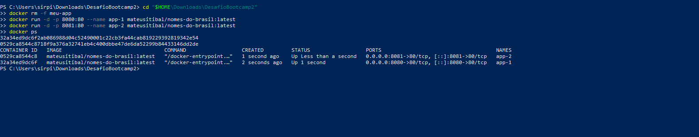

# Nomes do Brasil

## Autor
Mateus Itibal Gomes de Freitas – Matrícula 22502039

## Descrição
Aplicação web que mostra a popularidade de um nome no Brasil: quantas pessoas o têm, em que década ele foi mais usado, a divisão entre feminino e masculino e os estados onde é mais comum. Os nomes favoritos ficam salvos num banco de dados. Útil para curiosos, futuros pais escolhendo nome para o bebê e para quem gosta de dados sobre o Brasil.

## Links
- **Aplicação no ar (GitHub Pages):** https://mateusitibal-byte.github.io/DesafioBootcamp2/
- **Repositório GitHub:** https://github.com/mateusitibal-byte/DesafioBootcamp2
- **Imagem no Docker Hub:** https://hub.docker.com/r/mateusitibal/nomes-do-brasil

## Rodar com Docker (um comando)
```bash
docker run -d -p 8080:80 mateusitibal/nomes-do-brasil:latest
```
Depois abra http://localhost:8080 no navegador.

## API utilizada
- **API de Nomes do IBGE** (Censo 2010) — documentação: https://servicodados.ibge.gov.br/api/docs/nomes
- Endpoints consumidos:
  - `GET https://servicodados.ibge.gov.br/api/v2/censos/nomes/{nome}` — frequência por década
  - `GET https://servicodados.ibge.gov.br/api/v2/censos/nomes/{nome}?sexo=F` e `?sexo=M` — frequência por sexo
  - `GET https://servicodados.ibge.gov.br/api/v2/censos/nomes/{nome}?groupBy=UF` — proporção por estado

## Funcionalidades
- Buscar qualquer primeiro nome pelo campo de busca (botão ou tecla Enter)
- Testar nomes de exemplo com um clique
- Ver o total de pessoas com o nome no Brasil
- Ver a década de maior popularidade e o número de nascimentos nela
- Ver um gráfico de nascimentos por década
- Ver a proporção entre feminino e masculino
- Ver os 5 estados onde o nome é mais comum (proporção a cada 100 mil habitantes)
- **Favoritar** um nome pesquisado (salvo no banco de dados)
- Ver a lista **Meus favoritos**, que carrega ao abrir a página, e clicar num favorito para pesquisá-lo de novo
- **Excluir** um favorito
- Mensagens amigáveis para nome não encontrado, entrada inválida, API fora do ar ou banco indisponível

## Persistência de dados
- **Banco escolhido:** [Supabase](https://supabase.com) (PostgreSQL), acessado direto do frontend com a biblioteca `supabase-js`.
- **O que é salvo:** os nomes favoritos, com um resumo dos dados no momento em que foram salvos.
- **Operações:** criar (`insert`), listar (`select`, do mais recente ao mais antigo) e excluir (`delete`).
- **Estrutura da tabela `favoritos`** (script completo em [`banco.sql`](banco.sql)):

| Coluna | Tipo | Descrição |
|---|---|---|
| `id` | bigint (identity, chave primária) | Identificador gerado pelo banco |
| `criado_em` | timestamptz (padrão `now()`) | Data e hora em que o favorito foi salvo |
| `nome_item` | text, único | Nome favoritado (só letras, até 40 caracteres) |
| `dados_extra` | text | Resumo, ex.: "1.234.567 pessoas · pico nos 1980s" |

- **Limitação conhecida:** a aplicação não tem login. As políticas de acesso (RLS) liberam leitura, criação e exclusão para o papel público `anon`, então a lista de favoritos é compartilhada entre todos os visitantes e qualquer um pode excluir itens. A chave usada no código é a `publishable` (pública), feita para ficar no frontend. Para mitigar abusos, a tabela só aceita nomes com letras e de tamanho limitado, e a página exibe os dados do banco como texto (sem interpretar HTML).

## Como executar localmente
**Sem Docker:**
1. Clone: `git clone https://github.com/mateusitibal-byte/DesafioBootcamp2`
2. Abra o arquivo `index.html` no navegador

**Com Docker (construindo a imagem):**
```bash
docker build -t nomes-do-brasil .
docker run -d -p 8080:80 --name meu-app nomes-do-brasil
```
Abra http://localhost:8080.

## Sidequests

### SQ1 · .dockerignore
O arquivo [`.dockerignore`](.dockerignore) exclui do *contexto de build* tudo o que a aplicação não precisa para rodar: a pasta `.git` (o histórico inteiro do projeto), os arquivos `.md`, os prints, o script do banco e rascunhos. Quando rodamos `docker build`, o Docker primeiro empacota e envia toda a pasta do projeto para o motor do Docker. Ignorando esses arquivos, esse envio fica menor e o build fica mais rápido. Também evita que arquivos desnecessários ou sensíveis acabem dentro da imagem por engano (por exemplo, num `COPY . .`), o que deixaria a imagem maior.

### SQ2 · Versionamento de imagem
A imagem foi publicada com três tags no Docker Hub:
- `1.0` — primeira versão funcional (busca no IBGE + favoritos no Supabase)
- `1.1` — melhoria: confirmação antes de excluir um favorito
- `latest` — aponta para a versão mais recente (1.1)

### SQ3 · Descrição no Docker Hub
O *overview* do repositório no Docker Hub descreve a aplicação, traz o comando `docker run` pronto para copiar e o link deste repositório GitHub.

### SQ4 · Explorando a orquestração
Dois containers da mesma imagem rodando ao mesmo tempo, nas portas 8080 e 8081:

```bash
docker run -d -p 8080:80 --name app-1 mateusitibal/nomes-do-brasil:latest
docker run -d -p 8081:80 --name app-2 mateusitibal/nomes-do-brasil:latest
docker ps
```



**Se eu tivesse 100 containers, como gerenciaria?** Subir e acompanhar 100 containers à mão, com `docker run` um por um, seria inviável: alguém teria que escolher portas, perceber quando um cai e reiniciá-lo, e distribuir a carga entre eles. É para isso que existem orquestradores como o **Kubernetes**. Nele, um **cluster** é o conjunto de máquinas (os *nós*) que o Kubernetes administra como se fosse um único computador. A menor unidade que ele executa é o **pod**, que embrulha um ou mais containers que precisam rodar juntos. Em vez de dar ordens container por container, eu declararia o estado desejado — "quero 100 **réplicas** desta imagem" — e o Kubernetes se encarregaria de distribuí-las entre os nós, recriar automaticamente as que falharem e espalhar os acessos entre elas. Para atualizar a versão, bastaria trocar a tag da imagem (por exemplo, de `1.0` para `1.1`) e ele substituiria as réplicas aos poucos, sem tirar a aplicação do ar.
